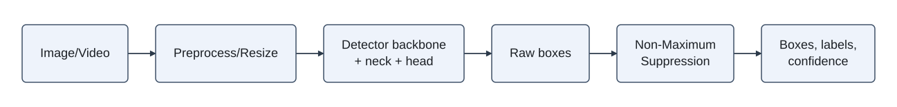

# DetectIt

**See it, then box it.** Object detection with bounding boxes, class labels, and confidence.

## Overview

DetectIt is a learning and portfolio project for object detection, one step up from image classification. Classification names the thing in the picture. Detection also says where it is: a box, a class, and a confidence for each object.

The work starts from a pretrained Ultralytics YOLO model on the 80 COCO classes, draws those predictions, and then fine-tunes the same model on a small custom set. The custom set is an Indonesian street scene, motorbikes and helmets or a wider set of street vehicles. A Faster R-CNN baseline from torchvision is an optional comparison.

The repository includes an inference CLI, a fine-tuning and evaluation pipeline, and a Streamlit demo. DetectIt scores are backed by archived runs under `eval/runs/`. The evaluation rules are in [PLAN.md](PLAN.md).

## How it works



1. **Image/Video.** An uploaded image, a frame from a video file, or a webcam frame.
2. **Preprocess/Resize.** Decode the frame and resize it to the input size the checkpoint was trained with. The original size is kept, so the boxes can be drawn on the picture the person actually uploaded.
3. **Detector backbone + neck + head.** The backbone extracts features, the neck combines them across scales, and the head proposes class scores and boxes.
4. **Raw boxes.** The head's candidates, before filtering. Many of them overlap.
5. **Non-Maximum Suppression.** Remove candidates below the confidence threshold, then drop overlapping boxes of the same class whose overlap is above the IoU threshold.
6. **Boxes, labels, confidence.** The boxes the demo draws, and the boxes the per-class count table counts.

## Features

- Pretrained inference with an Ultralytics nano detector. YOLO11n is the default checkpoint. YOLOv8n is the same-size alternative, selected in config.
- Boxes drawn with the class name and the confidence.
- Confidence and IoU thresholds that the demo can move.
- A Streamlit app to upload an image or a video, inspect the boxes, and read a per-class count table. Webcam input is optional once upload works.
- Fine-tuning on a small custom dataset, starting from the pretrained weights.
- A browser-camera still using the same detection pipeline as uploaded images.
- An evaluation script that writes a log and a metrics file, so a number in this README can be traced to a command.

## Datasets

**COCO.** The pretrained checkpoints are Ultralytics models trained on [COCO](https://cocodataset.org). Detection uses the 80-class label set. The official splits stay as COCO published them. This repository does not redistribute COCO images.

**Custom set, Indonesian street context.** The first fine-tune uses an InaTRC subset for vehicle detection on Indonesian toll roads. Helmet detection remains an alternative experiment with its own config.

Candidate public sets on Roboflow Universe, both using Indonesian class names for helmet use:

- [motocyclehelmet_detection](https://universe.roboflow.com/deteksihelm/motocyclehelmet_detection) (`pakai-helm`, `tidak-pakai-helm`)
- [Deteksi Helm Kendaraan Bermotor](https://universe.roboflow.com/abdul-jalil-azis/deteksi-helm-kendaraan-bermotor-pwech) (`pakai helm`, `tanpa helm`)

Images we label ourselves are the other source, if a public set's license or label quality does not fit. The dataset manifest records the source, version, license, and frozen splits before training. Original images live under `data/`.

## Tech stack

- Python
- PyTorch
- Ultralytics
- OpenCV
- Streamlit
- torchvision, for the optional Faster R-CNN baseline

## Project structure

```text
data/                 datasets and downloaded weights (gitignored)
notebooks/            box-format checks and sample drawings
src/detectit/
  data/               loading, splits, box-format conversion
  models/             YOLO wrapper and optional Faster R-CNN
  train/              fine-tuning loop
  eval/               metric helpers used by the scripts
  utils/              drawing, counts, seeding
eval/                 scripts that write logs and metrics JSON
app/                  Streamlit demo
configs/              one YAML per experiment
tests/
docs/                 pipeline.svg and pipeline.png
```

## Getting started

Run the commands from the repository root with Python 3.12.

### Install

```bash
python -m venv .venv
source .venv/bin/activate
```

On CPU-only Linux, install the PyTorch CPU wheels first.

```bash
pip install torch==2.6.0 torchvision==0.21.0 --index-url https://download.pytorch.org/whl/cpu
```

Install DetectIt and its demo and test dependencies.

```bash
pip install -e ".[app,dev]"
pytest
```

### Inference

```bash
python -m detectit.predict --config configs/yolo11n-coco.yaml --source path/to/image.jpg
```

The annotated PNG and the raw JSON are saved to `outputs/`. Choose
`configs/yolov8n-coco.yaml` to use YOLOv8n. Pretrained weights are downloaded
into `data/checkpoints/` on first use.

### Evaluate on COCO

Download the official validation images and annotations. Add `--limit 8` for a smoke run, which is excluded from reported results.

```bash
python -m detectit.data.download_coco
python eval/evaluate.py --config configs/yolo11n-coco.yaml --split val --batch 8
```

The script writes `eval/runs/<run-id>/metrics.json` together with the log, the resolved config, and the environment. A number enters this README only from that JSON.

### Fine-tune on Indonesian vehicles

The reproducible experiment uses InaTRC v1 (Chasanah et al., CC BY 4.0).
Its five classes group non-truck vehicles together and distinguish trucks by
axle count. The DetectIt subset uses the published train, validation, and
test folders, excludes images with byte-identical copies, then selects a
seeded sample inside each split while retaining every class. Download the
archive using **Download All** and keep its published folder structure. [InaTRC v1](https://doi.org/10.17632/kddgphck3b.1) · [CC BY 4.0](https://creativecommons.org/licenses/by/4.0/)

```bash
mkdir -p data/inatrc
unzip /path/to/inatrc.zip -d data/inatrc
python -m detectit.data.prepare --config configs/finetune-inatrc.yaml \
  --root 'data/inatrc/InaTRC Indonesia Toll Road Vehicle Classification Dataset' \
  --name InaTRC --version '1 (DetectIt seed-42 subset)' \
  --license 'CC BY 4.0' --source 'https://doi.org/10.17632/kddgphck3b.1' \
  --names 'Non-truck' 'Two-axle truck' 'Three-axle truck' 'Four-axle truck' 'Five-plus-axle truck'
python eval/train.py --config configs/finetune-inatrc.yaml --device cpu --workers 0
```

Training saves the learning curve, train/validation metrics, and `best.pt`
in its run directory. Use the generated checkpoint YAML for validation and
finalize its thresholds before committing it under `configs/` and running
the held-out test once. A fresh training run produces a new YAML with that
run's checkpoint path and hashes.

```bash
cp eval/runs/<train-run-id>/checkpoint.yaml configs/inatrc-local.yaml
python eval/evaluate.py --config configs/inatrc-local.yaml --split val --device cpu
git add configs/inatrc-local.yaml
git commit -m "Freeze local InaTRC checkpoint config"
python eval/evaluate.py --config configs/inatrc-local.yaml --split test --device cpu
```

For helmets, use the same commands with `configs/finetune-helmets.yaml` and
supply the dataset's own source, license, version, and class names in YOLO
ID order. The default layout is `train|val|test/{images,labels}` (also
accepting `valid`). Use `--layout standard` for an `images/{train,val,test}`
export or `--layout unsplit` for `images/` and `labels/` without published
splits. Place datasets under `data/`. Use an empty label file for an image with no objects. The notebook previews annotations from the frozen InaTRC training split. [Annotation notebook](notebooks/inspect_inatrc_labels.ipynb)

### Run the app

```bash
streamlit run app/streamlit_app.py
```

Upload an image or a video, or switch to **Camera** to capture a still.
The count table refers to the displayed frame. To use a custom checkpoint,
place its YAML in `configs/` and make sure its local weight path exists.
Select **No checkpoint** to preview the upload without inference.

## Results

Detailed metrics and per-class AP are stored alongside each run.

## Roadmap

1. Pretrained YOLO inference on images, with boxes, labels, and confidence.
2. An evaluation script, then a comparison with the published COCO mAP of the loaded checkpoint.
3. A small custom dataset, split into train, validation, and test before any training.
4. Fine-tuning, with every model choice made on validation.
5. The Streamlit demo: upload, thresholds, boxes, and a per-class count table.
6. Optional Faster R-CNN comparison and live webcam streaming.

Tasks, metric definitions, and the evidence rule are in [PLAN.md](PLAN.md).

## Related projects

Sibling learning projects by [cendysaputra](https://github.com/cendysaputra):

- [VisionClassify](https://github.com/cendysaputra/VisionClassify) — CNN image classification on CIFAR-10, 95.71% test accuracy.
- [ExplainVision](https://github.com/cendysaputra/ExplainVision) — Grad-CAM explainability.
- [AudioScope](https://github.com/cendysaputra/AudioScope) — spectrogram sound classification.
- [VecScope](https://github.com/cendysaputra/VecScope) — embedding explorer.

## License

The [MIT LICENSE](LICENSE) covers original DetectIt source and documentation.
The integrated Ultralytics dependency is AGPL-3.0. Distribution and network
use of the combined work must honor the applicable AGPL corresponding-source
terms. Datasets and third-party weights retain their own licenses. [Ultralytics license](https://github.com/ultralytics/ultralytics/blob/main/LICENSE)
